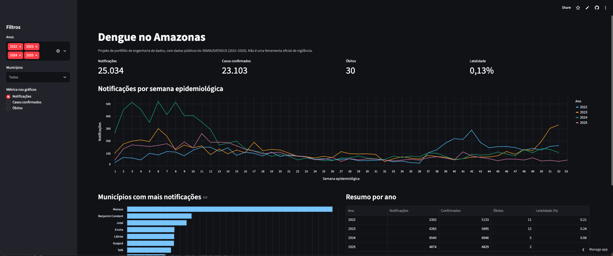

# Vigilância da Dengue no Amazonas — Pipeline SINAN

Pipeline de dados que transforma as notificações públicas de dengue do SINAN (Ministério da Saúde / DataSUS) em indicadores semanais por município, simulando o trabalho de uma equipe de dados que apoia a vigilância epidemiológica do Amazonas, de 2022 a 2025.

**Painel online:** https://sinan-vigilancia-am.streamlit.app/

## 1. Contexto de negócio

> Projeto de portfólio construído sobre dados públicos reais. Ele simula o trabalho de uma equipe de dados que apoia a vigilância epidemiológica.

**Cenário.** A vigilância em saúde precisa acompanhar, semana a semana e município a município, quantos casos de dengue foram notificados, quantos foram confirmados, quantos evoluíram para formas graves, quantos foram internados e quantos morreram. O microdado público do SINAN não entrega isso pronto: as colunas vêm todas como texto, as categorias vêm codificadas, a idade vem em um código de unidade e valor, campos vazios vêm como texto em branco, não há número de notificação e o ano do arquivo não é o ano da notificação.

**Objetivo.** Entregar uma camada analítica confiável, em que quem for analisar a dengue no Amazonas não precise repetir a limpeza a cada consulta, e um painel que torne essa camada legível para quem não escreve SQL.

**O que o projeto entrega.**

| | |
|---|---|
| Período analisado | 2022–2025 |
| Notificações no pipeline | 25.071 (25.034 de 2022–2025 e 37 residuais de 2026) |
| Óbitos por dengue | 30 |
| Municípios com notificação | 54 de 62 |
| Reconciliação silver ↔ gold | Conferida por consulta: nenhuma notificação perdida ou criada |
| Testes automáticos | 18, executados a cada `dbt build` |
| Ciclo completo (extração → painel) | cerca de 3 minutos |
| Tabela final | Uma linha por semana epidemiológica e município, com nome do município, notificações, confirmados, sinais de alarme, graves, internações, óbitos e letalidade |

Exemplo de pergunta que a camada gold responde em uma consulta, os dez municípios com mais óbitos:

```sql
select nome_municipio,
       sum(notificacoes)       as notificacoes,
       sum(casos_confirmados)  as confirmados,
       sum(obitos)             as obitos
from sinan_vigilancia.gold.gld_dengue_semana_municipio
group by nome_municipio
order by obitos desc
limit 10;
```

## 2. Painel



Painel público em Streamlit: https://sinan-vigilancia-am.streamlit.app/

**O que mostra.**
- Indicadores do recorte escolhido: notificações, casos confirmados, óbitos e letalidade.
- Curva semanal por ano epidemiológico, para comparar a sazonalidade entre 2022 e 2025.
- Os dez municípios com mais notificações.
- Resumo por ano, com filtros de ano, município e métrica.

**De onde vêm os dados.** O painel lê um snapshot em Parquet (13 KB, 2.813 linhas) exportado da camada gold pela última tarefa da DAG. Ele não guarda credenciais e não consulta o Databricks em tempo real.

**Período.** O painel cobre 2022–2025. As 37 notificações de 2026 (semanas 1 a 19) que vêm dentro do arquivo de 2025 existem no pipeline, mas ficam fora do painel.

**Cuidado na leitura da letalidade.** A letalidade cai de 0,21% (2022) para 0,04% (2025). Parte dessa queda pode refletir óbitos ainda em investigação nos anos recentes, e não menor gravidade.

**Hospedagem.** O painel roda no plano gratuito do Streamlit Community Cloud, que hiberna após um período sem acessos. O primeiro acesso depois disso leva cerca de 30 segundos para acordar.

## 3. Arquitetura

```mermaid
flowchart LR
    subgraph FONTES["Fontes públicas"]
        SINAN["<b>FTP do DataSUS</b><br/>SINAN – Dengue"]
        IBGE["<b>API de localidades do IBGE</b><br/>62 municípios do AM"]
    end

    VOL[("<b>Volume do Databricks</b><br/>landing")]

    subgraph DBT["③ dbt build — transformação e testes"]
        direction LR
        BRZ[("<b>Bronze</b><br/>dado bruto, tudo em texto")]
        SLV[("<b>Silver</b><br/>tipado e deduplicado")]
        GLD[("<b>Gold</b><br/>indicadores por semana<br/>e município, com nome")]
        SEED["<b>ref_municipios_am</b><br/>seed do dbt"]
        BRZ --> SLV --> GLD
        SEED --> SLV
    end

    PQ["<b>Parquet</b><br/>snapshot da gold"]
    APP["<b>Painel Streamlit</b><br/>público"]

    SINAN -->|"① extrair: pysus + DuckDB, filtra UF = AM<br/>② carregar: envia o Parquet"| VOL
    VOL --> BRZ
    IBGE -.->|"script Python fora da DAG<br/>CSV versionado no repositório"| SEED
    GLD -->|"④ exportar_gold"| PQ
    PQ --> APP

    subgraph AIRFLOW["Orquestração: Apache Airflow (Docker) — DAG sinan_dengue_am, toda segunda às 6h"]
        direction LR
        T1["① extrair_sinan_dengue"] --> T2["② carregar_no_volume"] --> T3["③ dbt_build"] --> T4["④ exportar_gold"]
    end

    classDef fonte fill:#dbeafe,stroke:#2563eb,color:#0f172a
    classDef armazenamento fill:#e5e7eb,stroke:#6b7280,color:#0f172a
    classDef bronze fill:#fde4c8,stroke:#b45309,color:#0f172a
    classDef silver fill:#e2e8f0,stroke:#64748b,color:#0f172a
    classDef gold fill:#fef08a,stroke:#ca8a04,color:#0f172a
    classDef painel fill:#bbf7d0,stroke:#16a34a,color:#0f172a
    classDef tarefa fill:#ede9fe,stroke:#7c3aed,color:#0f172a

    class SINAN,IBGE fonte
    class VOL,PQ armazenamento
    class BRZ bronze
    class SLV,SEED silver
    class GLD gold
    class APP painel
    class T1,T2,T3,T4 tarefa
```



| Camada | Modelo | Conteúdo |
|---|---|---|
| bronze | `brz_sinan_dengue` | Dado bruto, tudo como texto, com arquivo de origem e data de carga |
| silver | `slv_sinan_dengue` | Datas tipadas, categorias decodificadas, idade em anos, chave da notificação e deduplicação |
| silver | `ref_municipios_am` | Seed com código e nome dos 62 municípios do Amazonas (IBGE) |
| gold | `gld_dengue_semana_municipio` | Indicadores por semana epidemiológica e município, com o nome do município |

**DAG `sinan_dengue_am`** (toda segunda-feira às 6h, sem catchup):

| Ordem | Tarefa | O que faz |
|---|---|---|
| 1 | `extrair_sinan_dengue` | Baixa o SINAN via pysus, filtra o AM com DuckDB e grava Parquet |
| 2 | `carregar_no_volume` | Envia os Parquet ao Volume do Databricks pela Files API |
| 3 | `dbt_build` | Roda seed, modelos e testes |
| 4 | `exportar_gold` | Exporta a gold para o Parquet que alimenta o painel |

Cada tarefa tem 2 retentativas com intervalo de 5 minutos, e a DAG tem SLA de 30 minutos. Uma execução completa a frio leva cerca de 3 minutos.

**Stack:** Python · pysus · DuckDB · Parquet · Databricks (Unity Catalog, Delta) · dbt · Apache Airflow · Docker Compose · Streamlit · Altair

## 4. Decisões técnicas e trade-offs

**Databricks como warehouse, em vez de banco local.**
O processamento pesado roda no serverless do Databricks e não na máquina de desenvolvimento, que tem 8 GB de RAM. Ganho: o pipeline escala sem mudar o código. Custo: dependência de um serviço gerenciado e nenhuma configuração de cluster para ajustar.

**DuckDB para filtrar antes de subir os dados.**
O arquivo nacional é grande para a memória disponível. O DuckDB lê o Parquet direto do disco e filtra pela UF sem carregá-lo inteiro. Ganho: extração leve e rápida. Custo: uma etapa a mais antes da carga.

**dbt para as transformações.**
Cada camada é um modelo versionado com testes declarativos. Ganho: governança, rastreabilidade e manutenção simples. Custo: uma ferramenta a mais para operar, que se justifica porque os testes de qualidade fazem parte do produto.

**Bronze tudo em texto, tipagem só na silver.**
O bronze preserva o dado exatamente como veio. A conversão para data e número usa funções seguras (`try_cast`, `try_to_date`), que viram nulo quando o valor é inválido. Ganho: a carga nunca quebra por um valor sujo. Custo: um valor inválido vira nulo sem aviso, e por isso os testes cobrem datas, idade e categorias.

**Chave da notificação por hash do registro completo.**
O arquivo público não traz número de notificação. A chave é o hash de todos os campos. Ganho: remove duplicatas exatas e permite testar unicidade. Custo: dois registros genuinamente idênticos seriam contados como um (aqui, 2 casos), e uma notificação reclassificada em uma carga posterior entra como registro novo. O tratamento de atualização com upsert é o próximo passo planejado.

**Ano da notificação, e não o ano do arquivo.**
Um arquivo anual traz registros de anos vizinhos, inclusive de 2026 dentro do arquivo de 2025 (37 notificações, semanas 1 a 19). Todas as agregações usam a data de notificação. Ganho: indicadores corretos por período. Custo: o número de registros por arquivo não equivale ao número por ano.

**Recorte pela UF notificante (`SG_UF_NOT = AM`).**
É o critério com que a vigilância atribui o caso à unidade que o notificou. Ganho: coerência com a rotina da vigilância. Custo: moradores do Amazonas notificados em outros estados ficam de fora.

**Nomes de município vindos de uma referência do IBGE, como seed do dbt.**
O SINAN usa o código de 6 dígitos do município, e a API de localidades do IBGE devolve 7. O script de extração ajusta o código e grava um CSV que o dbt carrega como seed na silver. Ganho: a gold sai legível, e um teste garante que nenhum código fica sem nome. Custo: a referência é estática e precisa ser regenerada se o IBGE mudar a lista.

**Dois ambientes virtuais no mesmo container.**
`pysus` e `dbt` têm requisitos de pacotes incompatíveis. Ganho: cada ferramenta roda com as versões que precisa. Custo: imagem maior e um caminho de execução específico para cada uma.

**Airflow em modo standalone (SQLite e SequentialExecutor).**
Suficiente para uma DAG semanal em um único container. Em produção, o metadados iria para Postgres e a execução para um executor distribuído (Celery ou Kubernetes). Por causa do SQLite, o ambiente é parado com `docker compose stop`, nunca com `down`, para não perder o estado.

**Painel lê um snapshot em Parquet, não o Databricks ao vivo.**
O painel público não precisa de credenciais e não consome o warehouse a cada visita. Ganho: segurança, custo zero e abertura instantânea. Custo: os dados só atualizam quando a DAG roda e o snapshot é versionado no repositório.

**Tabelas recriadas por completo a cada execução.**
Com 25 mil linhas, a recarga completa é simples, barata e livre de inconsistência. Custo: não escala para volumes grandes, e por isso o processamento incremental está no planejamento.

## 5. Qualidade de dados

`dbt build` executa 22 nós: 1 seed, 3 modelos e 18 testes.

- Unicidade e não nulidade da chave da notificação
- Valores aceitos para UF, sexo, classificação final, evolução e critério de confirmação
- Coerência cronológica: início dos sintomas não pode ser posterior à notificação
- Faixa de idade plausível (severidade de aviso)
- Grão único no gold (semana + município)
- Consistência das métricas do gold: óbitos, confirmados e internações nunca excedem as notificações, e a letalidade fica entre 0 e 100
- Todo município do gold tem nome (cruzamento com a referência do IBGE)
- Código de município único na referência do IBGE

A reconciliação entre silver e gold (os totais batem) é conferida por consulta, fora do `dbt build`.

Características da fonte que o pipeline respeita: cerca de 7,6% das notificações são inconclusivas, os arquivos públicos não trazem casos descartados e o ano mais recente pode ser preliminar.

## 6. Evolução

| Etapa | Status |
|---|---|
| Extração da fonte oficial (4 anos) | Concluída |
| Camadas bronze, silver e gold | Concluídas |
| Testes de qualidade em todas as camadas | Concluídos |
| DAG do Airflow de 4 tarefas, com retentativas e SLA | Concluída |
| Referência de municípios do IBGE via API, com nomes na gold | Concluída |
| Painel em Streamlit publicado | Concluído |
| Taxas por habitante, com população do IBGE | Planejada |
| Processamento incremental com upsert na silver | Planejado |
| Cruzamento com estabelecimentos de saúde pelo CNES | Planejado |

## 7. Como executar

Pré-requisitos: Docker, uma conta Databricks com o catálogo `sinan_vigilancia`, os schemas `bronze`, `silver` e `gold` e o Volume `bronze.landing`.

1. Copie `.env.example` para `.env` e preencha o host do Databricks, o HTTP path do SQL warehouse e o token de acesso.
2. Suba o ambiente:

```bash
docker compose up -d
```

3. Ative e dispare a DAG (uma instância nova do Airflow começa com as DAGs pausadas):

```bash
docker exec -it airflow-sinan airflow dags unpause sinan_dengue_am
docker exec -it airflow-sinan airflow dags trigger sinan_dengue_am
docker exec -it airflow-sinan airflow dags list-runs -d sinan_dengue_am
```

4. A interface do Airflow fica em `http://localhost:8080`. A senha do usuário admin está em `/opt/airflow/standalone_admin_password.txt`, dentro do container.

5. Para rodar o painel localmente:

```bash
cd app
python -m venv .venv && source .venv/bin/activate
pip install -r requirements.txt
streamlit run app.py
```

6. Para encerrar sem perder o estado do Airflow, use `docker compose stop`.

## 8. Estrutura

```
.
├── docker-compose.yml
├── Dockerfile
├── extract/
│   ├── dengue/           # extração do SINAN (pysus → Parquet)
│   └── ibge/             # municípios do AM (API do IBGE → seed)
├── dbt/
│   ├── models/{bronze,silver,gold}/
│   ├── seeds/            # ref_municipios_am.csv
│   ├── tests/
│   └── macros/
├── airflow/dags/         # DAG sinan_dengue_am
├── app/                  # painel Streamlit e snapshot em Parquet
├── docs/                 # imagens do README
└── .env.example
```

## Fontes dos dados

- Ministério da Saúde — SINAN (Sistema de Informação de Agravos de Notificação), via DataSUS. Dados públicos.
- IBGE — API de localidades, para a lista de municípios do Amazonas.
